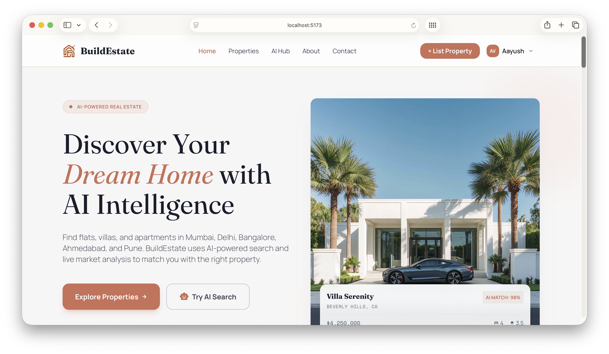
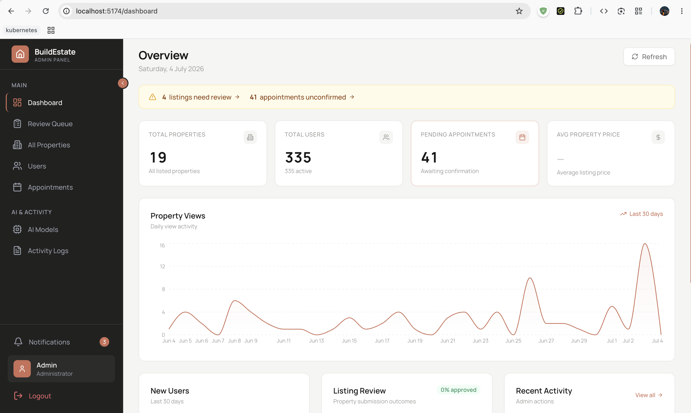
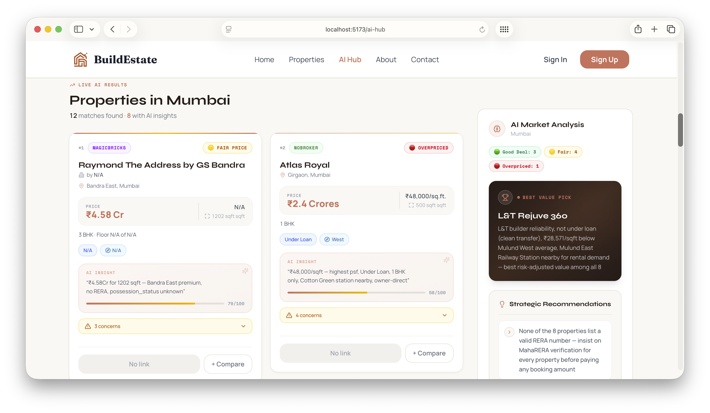
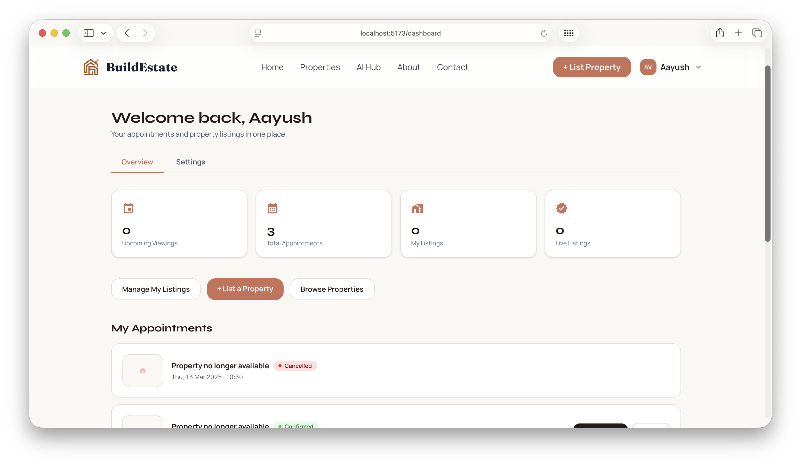

# 🏡 Real-State-Platform (BuildEstate)

A modern, full-stack, enterprise-grade real estate ecosystem featuring property discovery, listing management, comprehensive admin dashboard, appointment booking, and an **AI-powered Property Hub** with live market intelligence.

---

## 📑 Table of Contents

- [Overview](#-overview)
- [Screenshots & Preview](#-screenshots--preview)
- [Monorepo Architecture](#-monorepo-architecture)
- [Key Features](#-key-features)
- [Tech Stack](#-tech-stack)
- [Getting Started](#-getting-started)
  - [Prerequisites](#prerequisites)
  - [1. Backend Setup](#1-backend-setup)
  - [2. Frontend Setup](#2-frontend-setup)
  - [3. Admin Dashboard Setup](#3-admin-dashboard-setup)
- [Environment Configuration](#-environment-configuration)
- [API Endpoints Overview](#-api-endpoints-overview)
- [Deployment](#-deployment)
- [License](#-license)

---

## 🌟 Overview

**BuildEstate** is structured as an end-to-end real estate solution split into three distinct modules:
1. **Frontend (`/frontend`)**: Responsive client portal for buyers, renters, and property owners.
2. **Admin Panel (`/admin`)**: Operations dashboard to audit listings, manage appointments, configure AI models, and supervise user activities.
3. **Backend API (`/backend`)**: Robust REST API backed by Node.js, Express, MongoDB, and ImageKit CDN.

---

## 📸 Screenshots & Preview

<div align="center">
  <h3>🏠 User Homepage</h3>
  

  <br/><br/>

  <h3>📊 Admin Management Dashboard</h3>
  

  <br/><br/>

  <h3>🤖 AI Property Hub & Analytics</h3>
  
  &nbsp;&nbsp;
  
</div>

---

## 🏛 Monorepo Architecture

```text
Real-State-Platform/
├── admin/                  # React + Vite Admin Control Panel (Port 5174)
│   ├── src/
│   │   ├── components/     # Modals, Navbar, Sidebar, ProtectedRoute
│   │   ├── pages/          # Dashboard, Listings, Approvals, Users, AI Models
│   │   └── services/       # Axios API client
│   └── .env.example        # Admin environment template
│
├── backend/                # Node.js + Express REST API (Port 4000)
│   ├── config/             # MongoDB, ImageKit, Nodemailer configurations
│   ├── controller/         # Auth, Property, User, Appointment, Admin, AI
│   ├── middleware/         # JWT verification, Multer upload, Rate limiting
│   ├── models/             # Mongoose schemas (Property, User, Appointment, etc.)
│   ├── routes/             # Express API routing
│   └── .env.example        # Backend environment template
│
├── frontend/               # React 18 + TypeScript + Tailwind CSS (Port 5173)
│   ├── src/
│   │   ├── components/     # UI design system, Cards, Modals, Forms
│   │   ├── pages/          # Home, Properties, AI Hub, Dashboard, Auth
│   │   └── services/       # Frontend API communication
│   └── .env.example        # Frontend environment template
│
├── shared/                 # Shared TypeScript utilities (e.g., price formatters)
├── Image/                  # UI demo images and documentation assets
├── .gitignore              # Monorepo-wide security & ignore definitions
└── README.md               # Main project documentation
```

---

## ✨ Key Features

### 👤 User Portal
- **Property Discovery**: Search, filter, and sort properties by category, price, location, and amenities.
- **Detailed Listings**: High-definition image galleries, property specifications, floor plans, and interactive map locations.
- **Appointment Booking**: Schedule in-person or virtual property viewings with real-time confirmation.
- **User Dashboard**: Track booked appointments, saved properties, and submit personal listings for review.
- **Secure Authentication**: Email sign-up, JWT token-based login, email OTP verification, and password resets.

### 🛡️ Admin Dashboard
- **Analytics & KPIs**: Real-time traffic, conversion charts (via Recharts), and platform activity logs.
- **Review Queue**: Review user-submitted listings with approval/rejection workflows and full photo lightboxes.
- **Catalog Management**: Add, update, feature, or delete property listings with automated ImageKit uploads.
- **User Governance**: View registered users, analyze activity, and issue account suspensions or bans.
- **AI Model Switcher**: Configure and switch the backend LLM providers (NVIDIA NIM, GitHub Models, etc.) dynamically.

### 🤖 AI Property Hub
- **Live Market Web Scraping**: Live listing extraction from major portals via Firecrawl.
- **AI-Powered Evaluation**: Smart match score calculation, value verdicts, and automated red-flag detection.
- **Locality Trends**: Locality-level price trends, rental yield estimates, and appreciation outlook.

---

## 💻 Tech Stack

| Layer | Technologies |
|---|---|
| **Frontend** | React 18, TypeScript, Vite, Tailwind CSS v4, Lucide Icons, Framer Motion |
| **Admin Panel** | React 18, Vite, Tailwind CSS v3, Recharts, Sonner, Axios |
| **Backend** | Node.js (v18+), Express.js, Mongoose, JWT, Bcrypt |
| **Database** | MongoDB Atlas |
| **Media / Storage** | ImageKit.io (CDN image processing & delivery) |
| **Communications** | Nodemailer with Brevo (Sendinblue) REST API / SMTP |
| **AI & Scraping** | Firecrawl, NVIDIA NIM Inference, GitHub Models (GPT-4.1) |
| **Security** | Helmet, Express Rate Limiter, CORS, Mongo Sanitize |

---

## 🚀 Getting Started

### Prerequisites

Ensure you have the following installed on your machine:
- [Node.js](https://nodejs.org/) (v18.0.0 or higher)
- [npm](https://www.npmjs.com/) or [yarn](https://yarnpkg.com/)
- [MongoDB Atlas](https://cloud.mongodb.com/) account (or local MongoDB)
- [ImageKit](https://imagekit.io/) free account (for property images)
- [Brevo](https://www.brevo.com/) account (for email verification & notifications)

---

### 1. Backend Setup

```bash
# Navigate to backend directory
cd backend

# Install dependencies
npm install

# Create environment file from example
cp .env.example .env.local

# Fill in your variables in .env.local (see Environment Configuration below)

# Start backend server in development mode
npm run dev
```

The backend server will run at **`http://localhost:4000`**.

---

### 2. Frontend Setup

```bash
# Open a new terminal and navigate to frontend
cd frontend

# Install dependencies
npm install

# Create environment file from example
cp .env.example .env.local

# Start frontend development server
npm run dev
```

The frontend web app will run at **`http://localhost:5173`**.

---

### 3. Admin Dashboard Setup

```bash
# Open a new terminal and navigate to admin
cd admin

# Install dependencies
npm install

# Create environment file from example
cp .env.example .env.local

# Start admin development server
npm run dev
```

The admin panel will run at **`http://localhost:5174`**.

---

## 🔑 Environment Configuration

### Backend (`backend/.env.local`)

| Variable | Description | Example |
|---|---|---|
| `PORT` | Server listening port | `4000` |
| `NODE_ENV` | Application environment | `development` |
| `BACKEND_URL` | Base backend server URL | `http://localhost:4000` |
| `MONGO_URI` | MongoDB connection URI | `mongodb+srv://<user>:<pwd>@cluster.mongodb.net/buildestate` |
| `JWT_SECRET` | Secret key for signing tokens | `generate_with_openssl_rand_hex_32` |
| `ADMIN_EMAIL` | Default admin login email | `admin@buildestate.com` |
| `ADMIN_PASSWORD` | Default admin login password | `SuperSecureAdminPassword123` |
| `WEBSITE_URL` | Frontend origin for CORS | `http://localhost:5173` |
| `IMAGEKIT_PUBLIC_KEY` | Public key from ImageKit dashboard | `public_xxxxxxxx` |
| `IMAGEKIT_PRIVATE_KEY` | Private key from ImageKit dashboard | `private_xxxxxxxx` |
| `IMAGEKIT_URL_ENDPOINT` | URL endpoint from ImageKit | `https://ik.imagekit.io/your_id` |
| `BREVO_API_KEY` | Brevo (Sendinblue) API key for emails | `xkeysib-xxxxxxxx` |
| `EMAIL_USER` | Verified sender email address | `noreply@yourdomain.com` |
| `NVIDIA_API_KEY` | *(Optional)* NVIDIA NIM API key for AI Hub | `nvapi-xxxxxxxx` |
| `GITHUB_MODELS_API_KEY` | *(Optional)* GitHub Models PAT for AI fallback | `ghp_xxxxxxxx` |

### Frontend (`frontend/.env.local`)

| Variable | Description | Default |
|---|---|---|
| `VITE_API_BASE_URL` | Base URL pointing to the Backend API | `http://localhost:4000` |
| `VITE_ENABLE_AI_HUB` | Toggle to enable AI Property Hub locally | `true` |

### Admin (`admin/.env.local`)

| Variable | Description | Default |
|---|---|---|
| `VITE_BACKEND_URL` | Base URL pointing to the Backend API | `http://localhost:4000` |

---

## 📡 API Endpoints Overview

| Method | Endpoint | Description | Access |
|---|---|---|---|
| `POST` | `/api/user/register` | Register new user account | Public |
| `POST` | `/api/user/login` | Login user and issue JWT | Public |
| `POST` | `/api/user/verify-email` | Verify email OTP | Public |
| `GET` | `/api/property/list` | Get all approved properties | Public |
| `GET` | `/api/property/:id` | Get specific property details | Public |
| `POST` | `/api/property/add` | Submit listing for approval | Authenticated |
| `POST` | `/api/appointment/book` | Schedule a property viewing | Public / User |
| `POST` | `/api/admin/login` | Authenticate admin credentials | Public |
| `GET` | `/api/admin/pending-listings`| Retrieve pending user listings | Admin Only |
| `POST` | `/api/admin/approve-listing` | Approve property for live listing | Admin Only |
| `GET` | `/api/admin/users` | List all registered users | Admin Only |
| `GET` | `/api/ai-models` | List active AI models | Public |

---

## 🚢 Deployment

The project is structured with deployment configurations for modern cloud platforms:

- **Frontend & Admin**: Ready for deployment on [Vercel](https://vercel.com/) (`vercel.json` included in `frontend` and `admin`).
- **Backend API**: Ready for deployment on [Render](https://render.com/) (`render.yaml` and `Dockerfile` included in `backend`).

---

## 📄 License

This project is licensed under the [MIT License](LICENSE).
